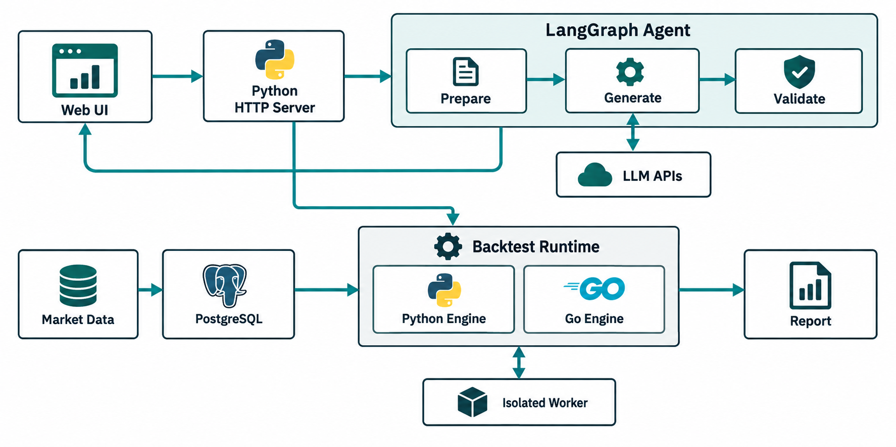

# Strategy Lab

**编写或配置策略，运行回测，检查收益与风险。** 一个可单机部署的日线策略研究工作台。真实行情采用 PostgreSQL 缓存，缺失或过期时按需从公开接口更新。

首页提供“策略输入、简单策略、运行回测、历史回测记录”四个入口。可以写 Python（默认）或 Go 策略代码，也可以用界面组合 RSI、MACD、均线和动量条件；两种语言各自独立运行，不要求用户比较语言。引擎不依赖聚宽、TA-Lib、pandas 或 NumPy；真实行情模式需要 PostgreSQL 和 `psycopg` 驱动。

> 界面默认使用真实行情和 PostgreSQL 缓存。另有 **800 个合成工作日、3 个虚构资产** 的演示数据，只用于验证程序；不能用演示收益证明策略有效。

## 项目框图



网页经 Python HTTP 服务提交策略描述和回测配置。LangGraph 依次准备上下文、调用所选模型、校验代码，并把过程通过 SSE 返回网页；校验通过的代码才进入编辑器。回测读取行情和 PostgreSQL 缓存，使用选定的 Python 或 Go 引擎生成报告；完整 Docker 部署中的自写代码由隔离 worker 执行。

## 快速开始

默认的真实行情模式需要 Python 3.12+、uv、Docker Desktop 和 PostgreSQL 驱动：

```sh
make setup-market
make run
```

打开 [http://127.0.0.1:8765](http://127.0.0.1:8765)。默认资产池包含 510300、518880、511010、513100（纳指 ETF）、600900（长江电力）、159687（南方亚太精选 ETF）和 512890（红利低波 ETF）。代码策略可直接写入其他六位沪深股票或 ETF 代码，回测时会自动补入资产池；无需加载全市场。首次回测会从公开日线接口抓取并写入 PostgreSQL，下一次相同区间优先查库。数据库及复权规则见 [真实行情说明](docs/DATA_SOURCES.md)。Docker 提供数据库和无网络的代码 worker，界面和两套回测引擎仍在本机运行。

要在**一台服务器上**运行应用、PostgreSQL 和离线代码 worker，请按 [单机 Docker 部署](docs/DEPLOY_DOCKER.md) 操作。代码回测和历史记录在完整部署中可用；本机 `make setup-market` 会启动隔离 worker，随后 `make run` 可回测自写代码。

已有 PostgreSQL 时，可设置 `STRATEGYLAB_DATABASE_URL` 并安装 `pip install -e '.[market]'`。Go 作为可选回测引擎需要 Go 1.23+，选择它时才会编译；网页无需 Node.js。只想检查规则时可在页面把数据来源切为“合成演示”，该模式不需要数据库。服务仅监听 127.0.0.1。

## 可以做什么

- 在“策略输入”页，左侧的 Agent 面板可用 DeepSeek、GPT、MiniMax、GLM、Kimi 生成代码草稿；顶部“Agent 生成”按钮会直接定位到策略描述框。右侧可自行编写或检查 Python / Go `decide` 策略，确认后再运行。生成过程由 LangGraph 编排，展示模型实际返回的流式片段，并结合项目内 Skill、当前资产池与持仓数；模型 API Key 由用户输入，不保存到历史记录。
- Agent 模型 ID 提供已核对的近期 API 选项，同时保留自定义 ID；GLM、Kimi 的国内站与国际站分开展示，使用对应站点的密钥。模型列表与接口说明见 [自写策略与 Agent](docs/USER_CODE.md)。
- 在“简单策略”页可视化增删入场/退出条件，支持 AND、OR、指标相互比较、数值阈值、上穿/下穿。
- 调整周期、MACD 参数、持仓数、排名方向、资金、手续费、滑点、交易单位和入场仓位上限。
- JSON 导入/导出，支持嵌套 AND/OR/NOT；复杂表达式保留在 JSON 中，不会被界面悄悄扁平化。
- 默认从 PostgreSQL 读取真实沪深股票/ETF 日线，缺失或过期时先尝试东方财富公开接口，连接失败则使用腾讯公开接口；实际来源逐资产记录。也可导入本地多资产 OHLCV CSV。
- 默认使用 Python；可切换为 Go，每次只执行所选运行方式。
- 以沪深300指数（`000300`）为默认基准，显示策略与基准曲线、日净值、最大回撤及恢复天数、Sharpe、Calmar、成本、实际仓位、订单、拒单。
- 完成的回测写入 PostgreSQL 历史记录，可重新打开完整报告及策略配置/代码。
- 代码策略的报告可点“基于此策略继续优化”，将当次代码、生成会话和有界回测反馈交给下一轮 Agent；反馈绑定代码指纹，修改后需重新回测。
- 下载完整实验 JSON 与成交 CSV。完整实验包含策略快照、数据与策略指纹、每日目标及持仓。
- 自带 RSI + MACD、RSI 回落后上穿、21 日动量轮动、买入持有四个可编辑模板。

## 不编写策略代码

例如“RSI < 35 且收盘高于 MA60”可以直接在界面配置，也可以写成：

```json
{
  "all": [
    {"left": "rsi14", "op": "lt", "right": 35},
    {"left": "close", "op": "gt", "right": "sma60"}
  ]
}
```

指标定义：

```json
{
  "rsi14": {"kind": "rsi", "period": 14},
  "sma60": {"kind": "sma", "period": 60},
  "macd_hist": {"kind": "macd", "fast": 12, "slow": 26, "signal": 9, "output": "hist"}
}
```

支持 `sma / ema / rsi / macd / roc / momentum_score / atr / highest / lowest`，以及 OHLCV 原始字段。完整配置参见 [examples/trend.json](examples/trend.json) 和 [执行规范](docs/SEMANTICS.md)。

指标目录之外的新指标仍需要分别实现两种语言版本并增加一致性测试；不能把任意表达式字符串当代码执行。

## 独立命令行

Go：

```sh
go run ./cmd/strategy-lab -strategy examples/trend.json -data examples/demo.csv -out /tmp/go-result.json
```

Python（**这条命令完全不需要 Go**）：

```sh
PYTHONPATH=python python3 -B -m strategylab --strategy examples/trend.json --data examples/demo.csv --out /tmp/python-result.json
```

Go 程序可调用 `engine.ParseStrategy` 和 `engine.Run`。Python 程序可调用：

```python
import json
from pathlib import Path
from strategylab import run

strategy = json.loads(Path("examples/trend.json").read_text())
data = Path("examples/demo.csv").read_bytes().decode("utf-8")
report = run(strategy, data)
```

**现有依赖 `jqdata` 的 `.py` 或任意 Go 策略不会自动转换。** 自写策略需要实现本项目的 `decide` 接口，详见 [自写策略与 Agent](docs/USER_CODE.md)。原 B 策略中的跨资产轮动速度与状态机没有在此自动移植，不能把“21 日动量轮动”模板当成 B 策略。

## 数据格式

```csv
date,symbol,open,high,low,close,volume
2024-01-02,510300,3.500,3.530,3.480,3.510,1000000
2024-01-03,510300,3.520,3.550,3.500,3.530,1100000
```

- 同一文件放多个资产；`symbol` 按文本读取，保留前导零。
- 可增加 `limit_up,limit_down`，单位为当日价格；缺省为 0，表示未提供涨跌停限制。
- `volume=0` 视为不可成交。日期必须为 `YYYY-MM-DD`，重复日期/资产、非有限数和不合理 OHLC 会直接拒绝。
- CSV 可以无序，引擎会排序。最多 100,000 行；网页上传小于 8 MB。
- 使用**同一种复权口径**；引擎不自动除权、派息或处理拆股。复权 OHLC 与原始涨跌停价不可混用。
- 为指标预热，CSV 应包含回测开始日以前的足够历史。资产池、基准代码需要真实存在于文件中。
- 实际日期来自输入行情，示例只排除周末，不模拟交易所节假日。研究真实策略必须使用真实交易日数据。

## 公平验证策略 A/B

选择一种运行方式即可；A/B 应比较策略条件的变化：

1. 固定数据、区间、池子、成本和执行规则，只改变要验证的策略条件，分别导出实验。
2. 比较完整日净值，检查最大回撤、恢复时间、Sharpe/Calmar、建仓数、拒单和实际仓位。
3. 预先划分训练/验证区间，冻结参数后再验证。没有自动寻优或自动授予“有效策略”的功能。

## 开发者测试

```sh
make test
make parity
```

开发测试才需要同时安装两种语言；跨语言核对仅用于维护实现一致性，不是用户回测流程。

测试包含手算成交/费用、持仓期间回撤、恢复天数、缺失行情、涨跌停、指标预热、历史前缀不变性，以及固定随机种子下多指标组合的跨语言对照。测试数据均为合成数据，不能作为投资结论。

## 项目结构

```text
cmd/strategy-lab/        Go 命令行
engine/                 独立 Go 指标、规则、回放与统计
python/strategylab/      独立 Python 引擎与对照器
web/                    无框架的可视化工作台
server.py               本地 HTTP 服务与固定引擎进程调度
worker.py               无网络的自写策略执行器
agent_codegen.py        LangGraph 策略草稿生成与流式模型适配
.agents/skills/strategy-lab-script/  可复用的策略生成 Skill
history.py              PostgreSQL 回测记录
compose.yaml             本机 PostgreSQL 17 服务
Dockerfile / compose.deploy.yaml  单机服务器应用与数据库部署
python/strategylab/market.py 公开行情、缓存与来源记录
compare.py              开发者实现一致性检查
examples/               JSON 模板、可重复生成的合成行情
schema/                 Strategy IR v1 JSON Schema
tests/                 Python 与跨语言测试
docs/                  指标口径、设计与验收记录
```

## 当前边界

当前支持日线、只做多、无杠杆、下一交易日开盘成交。没有实盘交易、分钟级撮合、盘口冲击模型、卖空、参数优化或多人账户。持仓上限在入场执行，已有持仓价格上涨后可以超过上限，不会隐式每日减仓。自写代码只决定目标持仓，不改写成交与费用规则。

完整部署使用单一管理员密码，应用端口默认只监听服务器本机；远程使用时通过 SSH 隧道或 HTTPS 反向代理。自写代码在无网络、无数据库密码的独立 worker 容器运行，不面向陌生用户提供多租户代码执行。真实行情来自网页公开接口，并非有服务等级保证的交易所数据服务。

## 开源与参考

采用 [MIT License](LICENSE)。代码发布于 [GitHub 项目](https://github.com/stevia0829/strategy-lab)，包含贡献指南、测试工作流与协议说明。

产品思路参考本地 hackthon 的 `strategylab-mvp`：可视化条件 → 版本化 Strategy IR → 确定性验证。这里重新实现了真实资金/持仓回放，不复制其演示收益，不引入 DreamDEX/Somnia SDK 或钱包逻辑。参见 [NOTICE](NOTICE)。
